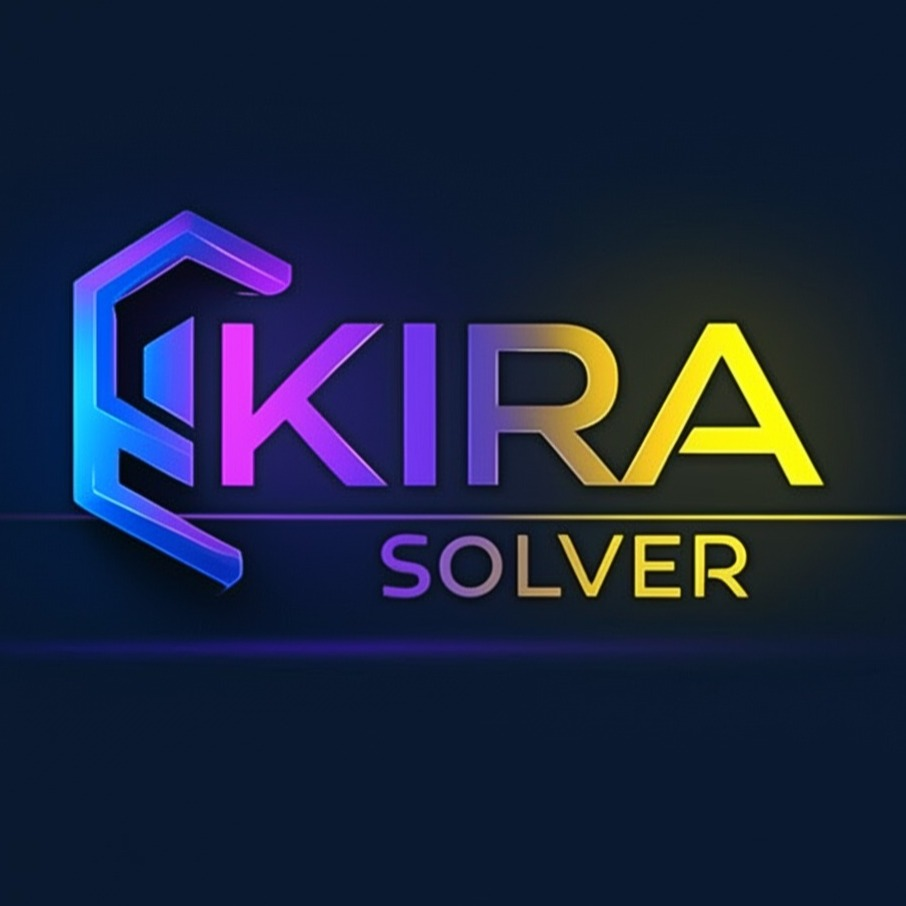

<div align="center">

  

  # ⚡ KIRA SOLVER 🤖

  <p align="center">
    <strong>Your Stealthy AI Coding & Interview Sidekick</strong><br />
    <em>Effortlessly cracks coding challenges, MCQs, and technical problems in real-time with Vision AI intelligence.</em>
  </p>

  <p align="center">
    <a href="https://github.com/satyamkumar420/kira-solver-app/releases"></a>
    
    
    
    
    
    
    
  </p>

</div>

---

## 🌟 Key Features

- **🌐 Universal OpenAI-Compatible Support**: Connect to any OpenAI-compatible provider:
  - **OpenAI** (`https://api.openai.com/v1`)
  - **OpenRouter** (`https://openrouter.ai/api/v1`)
  - **Groq** (`https://api.groq.com/openai/v1`)
  - **DeepSeek** (`https://api.deepseek.com/v1`)
  - **Local Ollama / vLLM / LM Studio** (`http://localhost:11434/v1`)
  - **Custom AI Gateways & Routers**
- **🔍 Auto-Fetch Models & Custom Input**:
  - Automatically fetch and list available models from your configured provider with one click.
  - Type or paste **any custom model ID** directly if not in the list.
  - Quick 1-click vision model presets (`gpt-4o`, `gpt-4o-mini`, `gemini-2.5-flash`, `claude-3.5-sonnet`, `qwen-vl`).
- **📸 Vision Screenshot Solver**:
  - Capture any area of your screen instantly using global shortcuts.
  - Automatically extracts code problems or MCQs from images and solves them with step-by-step logic, complexity analysis, and correct options.
- **📑 Multi-View Workflow**:
  - **Code Solver**: Provides optimal and brute-force DSA solutions with time/space complexity and detailed thoughts.
  - **MCQ Solver**: Extracts multiple-choice questions, highlights the correct answer, and explains all choices.
  - **Chat Assistant**: Interactive streaming conversation with the AI for explanations and follow-ups.
- **🕒 Unified History & Persistence**:
  - All past sessions, codes, and MCQs are automatically saved and organized locally.
  - Search and filter history anytime (`Ctrl + R` for fresh session).
- **🥷 Stealth & Window Controls**:
  - Global shortcuts to move window, toggle visibility, and control tabs stealthily.

---

## ⚠️ Important Note on AI Model Selection

> [!IMPORTANT]
> To use the **Screenshot Analysis (Code & MCQ Solver)** features, please ensure you configure a **Vision-Capable (Multimodal) Model** in Settings (⚙️).
> 
> **Recommended Vision Models:**
> - **OpenAI**: `gpt-4o`, `gpt-4o-mini`
> - **Google / OpenRouter**: `gemini-2.5-flash`, `google/gemini-2.5-flash`
> - **Anthropic / OpenRouter**: `anthropic/claude-3.5-sonnet`
> - **Qwen / OpenRouter / Groq**: `qwen/qwen-2.5-vl-72b-instruct`

---

## ⚙️ Configuration & Settings

1. Click the **⚙️ Settings** icon in the top toolbar.
2. Enter your **API Base URL** (Default: `https://api.openai.com/v1`).
3. Enter your **API Key** (e.g. `sk-...`).
4. Click **Auto-fetch Models** or type your desired model name in the **Model Name** field.
5. Click **Save Settings** — your configuration is securely persisted locally on your device.

---

## ⌨️ Keyboard Shortcuts

| Shortcut | Action |
| :--- | :--- |
| <kbd>Ctrl</kbd> + <kbd>H</kbd> | 📸 Capture Screenshot & Add to Current View |
| <kbd>Ctrl</kbd> + <kbd>Enter</kbd> | ⚡ Analyze Captured Screenshots & Solve |
| <kbd>Ctrl</kbd> + <kbd>B</kbd> | 👁️ Show / Hide Application Window |
| <kbd>Ctrl</kbd> + <kbd>T</kbd> / <kbd>Tab</kbd> | 📑 Switch to Next Tab (Code / MCQ / Chat) |
| <kbd>Ctrl</kbd> + <kbd>Shift</kbd> + <kbd>T</kbd> | 📑 Switch to Previous Tab |
| <kbd>Ctrl</kbd> + <kbd>R</kbd> | 🆕 Start Fresh Session (Clear View) |
| <kbd>Ctrl</kbd> + <kbd>↑ / ↓ / ← / →</kbd> | 🪟 Move Application Window on Screen |
| <kbd>Ctrl</kbd> + <kbd>Q</kbd> | 🚪 Quit Application |

*(On macOS, use <kbd>Cmd</kbd> instead of <kbd>Ctrl</kbd>)*

---

## 🛠️ Tech Stack

- **Desktop Framework**: [Electron](https://www.electronjs.org/)
- **Frontend**: [React 19](https://react.dev/), [TypeScript](https://www.typescriptlang.org/), [Vite](https://vitejs.dev/)
- **Styling**: [Tailwind CSS v4](https://tailwindcss.com/)
- **AI SDK**: [OpenAI Node SDK](https://github.com/openai/openai-node)
- **Markdown & Math**: KaTeX, Rehype, Remark-math, Prism Syntax Highlighter

---

## 🚀 Getting Started (Development)

### Prerequisites
- [Node.js](https://nodejs.org/en/) (v18 or later recommended)
- [npm](https://www.npmjs.com/)

### Installation & Run

1. **Clone the repository:**
   ```bash
   git clone https://github.com/satyamkumar420/kira-solver-app.git
   cd kira-solver-app
   ```

2. **Install dependencies:**
   ```bash
   npm install
   ```

3. **Start Development Server:**
   ```bash
   npm run dev
   # or on Windows PowerShell:
   ./dev.ps1
   ```

---

## 📦 Building for Production (.exe / installer)

To build the standalone Windows executable and installer:

```bash
npm run build
```

The compiled setup installer `.exe` will be generated inside the `release/` folder.

---

## 📄 License

This project is licensed under the MIT License — see the [LICENSE.txt](LICENSE.txt) file for details.
